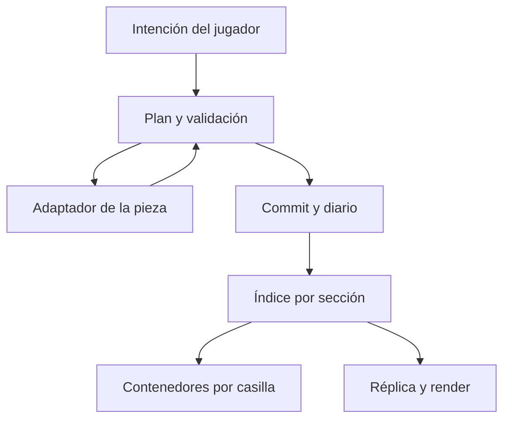

# Arquitectura

## Decisión principal

Núcleo geométrico independiente del mundo + puente NeoForge + adaptadores por familia. No se reemplaza globalmente el almacenamiento de bloques de Minecraft.

Una casilla especial usa un bloque contenedor NMG y su entidad para ofrecer al motor formas y propiedades agregadas. Los registros autoritativos de piezas viven por sección; cada casilla tiene referencias e instantáneas de ocupación para resolver consultas sin cargar regiones vecinas.

## Módulos previstos

| Módulo | Responsabilidad |
|---|---|
| core | Identidades, coordenadas, transformaciones y contratos |
| geometry | Intersección, contacto, trazados y recorte geométrico |
| world | Índices por casilla/sección y puente de contenedores |
| operation | Planificación, permisos, validación, commit y consecuencias |
| persistence | Formatos, migraciones, diario y recuperación |
| network | Protocolo, revisiones y réplica del cliente |
| client | Controles, vista previa, selección visual y render |
| material | Propiedades, loot y fragmentos |
| simulation | Apoyos, conexiones, luz, fluidos y mecanismos |
| api | Contratos públicos versionados |
| compat | Adaptadores vanilla y de otros mods |

Las clases comunes no importan clases exclusivas del cliente. Geometría pura se puede probar sin iniciar Minecraft. Los nombres son diseño, no APIs ya implementadas.

## Alternativas descartadas

- Una entidad del mundo por pieza: coste de seguimiento, colisión y guardado innecesario para construcciones estáticas.
- Un bloque registrado por combinación: explosión de variantes y pérdida de datos dinámicos.
- Simular todo mediante mundos falsos: comportamiento externo difícil de preservar.
- Convertir todo el mundo al cargar: riesgo y coste sin necesidad.
- Solo modelos visuales desplazados: no resuelve interacción ni colisión real.

## Puente con vanilla

Una pieza permanece nativa cuando posición, orientación, propiedades y ausencia de otros componentes permiten una representación exacta. Al necesitar composición se captura su estado mediante un adaptador y se realiza conversión transaccional. Si no puede capturarse de forma segura, se rechaza.

Cuando una única pieza vuelve a una forma nativa exacta, se restaura si el adaptador lo admite. No se intenta reducir un diseño externo a otro bloque por semejanza visual.

## Puntos que requieren comprobación ejecutable

Consultas de colisión/selección/apoyo, oclusión, iluminación, actualizaciones, guardado de chunks, render de 26.2 y capacidades. Se usarán extensiones públicas primero; si faltan, hooks mínimos y aislados con pruebas de versión. No se atribuye a NeoForge una API universal de multipiezas.

Ver [[Fuentes y evidencia]] y [[Riesgos y comprobaciones]].
